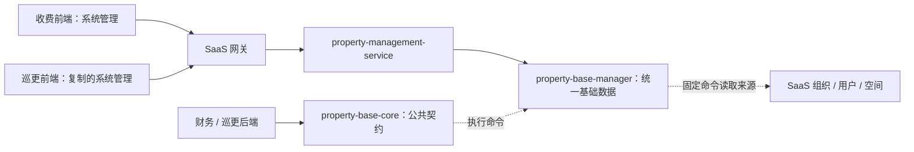

# 系统管理模块前后端开发与复用规范

适用范围：收费、财务、巡更等物业业务模块复用系统管理能力，以及后续维护物业基础模块。本文只规定前后端代码组织、模块复制接入、公共能力调用、权限、质量验证和交付方式。

## 1. 核心约定

**前端可以复制，后端统一复用，数据只维护一份。**

- “系统管理”是界面菜单名称；后端模块仍叫 `property-base`，不因菜单改名而更改包名、表名或接口前缀。
- 其他业务前端可以复制收费模块的系统管理页面、交互逻辑和依赖文件，注册到自己的模块和菜单下。
- 复制后的页面统一调用 `/property/**`，维护的是同一份物业基础数据。不能因前端属于巡更，就再建立一套巡更组织、用户或字典镜像。
- 后端业务模块禁止相互直接依赖 manager，禁止跨模块注入内部 Service、Repository 或直接查询、更新对方数据表。
- 后端跨模块协作通过公开 core 契约及 JetLinks 命令服务、代理或事件完成；尚未提供的契约先补契约，不绕过边界。
- 源组织、账号、空间结构由 SaaS 维护；物业维护类型、身份、空间与组织绑定、房屋和客户扩展资料。同步不覆盖物业补充数据，不向 SaaS 回写这些扩展。



## 2. 仓库和目录

| 内容 | 当前目录 / 仓库 | 约定 |
| --- | --- | --- |
| 物业后端 | `D:\Work\saas\property-management` | 一个物业后端仓库，多个业务模块，统一启动服务 |
| 基础公共契约 | `modules/property-base/property-base-core` | 公共 DTO、枚举、命令；不放 Entity、Repository 或 CRUD 实现 |
| 基础实现 | `modules/property-base/property-base-manager` | Controller、应用服务、实体、同步、权限、Excel、国际化 |
| 启动装配 | `services/property-management-service` | 装配各 manager、环境配置、SaaS 集群接入 |
| 前端宿主 | `D:\Work\saas\cloud.jetlinks\runtime-ui` | 登录、请求、权限、通用组件、动态模块加载和构建 |
| 复制参考 | `runtime-ui/modules/charging-management-ui` | 收费前端独立子仓库，源码不提交到宿主仓库 |
| 收费前端远程 | `git@github.com:jetlinks-v2/charging-management-ui.git` | 当前接入分支 `2.20` |

前端参考目录内部没有额外的 `src/` 层，`api/`、`hooks/`、`views/` 等直接位于模块根目录。以下前端相对路径均相对于 `charging-management-ui`。

## 3. 数据归属和维护边界

- 来源系统负责原始数据；物业基础模块负责本地扩展。字段归属必须明确，不能通过同步整对象覆盖本地扩展。
- 多个前端入口操作同一份基础数据，不各自建表、缓存成独立主数据或重复实现同步。
- 前端复制只改变模块所属及入口配置，不改变后端标识、数据归属和业务契约。
- 显示值、稳定编码、来源 ID 和物业扩展 ID 分开处理；不能用显示名称充当数据库关联键。
- 新增基础能力由基础模块提供受控公共接口，消费模块不直接读写基础表。

## 4. 前端复制接入

### 4.1 先确定复制范围

推荐先保留原目录相对结构，复制完成并验证后再调整目录，避免漏掉深层依赖。复制页面不能只复制一个 `index.vue`。

| 要复制的能力 | 页面 | 配套逻辑与依赖 |
| --- | --- | --- |
| 组织配置 | `views/charging/OrganizationType/` 全目录，含 CSS、空间绑定及预览 | `api/organization.ts`、`api/archive.ts`；`hooks/useOrganizationType.ts`、`hooks/archive/useOrganizationSpaces.ts`；`utils/organizationTree.ts`、`utils/requestError.ts` |
| 用户管理 | `views/charging/User/` 全目录，含 CSS | `api/user.ts`、`api/organization.ts`；`hooks/useUserList.ts`、`useUserDetail.ts`、`useUserSync.ts`；`utils/userQuery.ts`、`utils/requestError.ts`；`views/charging/components/archive-drawer.css` |
| 空间管理 | `views/charging/Space/` | `api/archive.ts`、`api/project.ts`；`hooks/archive/` 中范围、字典、房屋编辑、Excel 逻辑；公共 components 和对应 utils |
| 客户管理 | `views/charging/Customer/` | `api/archive.ts`、`api/user.ts`、`api/project.ts`；客户、空间记录、范围、字典、Excel hooks；公共 components 和对应 utils |
| 字典配置 | `views/charging/Dictionary/` | `api/archive.ts`；`hooks/archive/useDictionaryManager.ts`、`useDictionaries.ts`；`utils/requestError.ts`；公共样式 |

`api/archive.ts` 自身引用 `api/user.ts`、`utils/historyQuery.ts`、`utils/archiveFiles.ts`，后者还引用 `utils/requestError.ts`，这些依赖不能漏。实际复制以各文件 `import` 和 `<style src>` 的完整依赖为准。

**复制完整系统管理时，直接复制以下业务目录，最容易保持完整：**

```text
api/                         # user / organization / archive / project
hooks/                       # 含 archive 子目录
utils/
views/charging/               # OrganizationType / User / Space / Customer / Dictionary / components
locales/lang/zh.json          # 合并所需命名空间，不覆盖目标已有文案
locales/lang/en.json
tests/                       # 同步迁移相关行为测试，并调整模块路径和权限断言
```

这些是源模块的复制范围；若目标目录已存在同名文件，应逐项合并。不能覆盖目标模块原有的业务 API、hooks、文案或测试。

共用组件主要在 `views/charging/components/`，包括 `ArchiveWorkspace`、`ExcelActions`、`ArchiveImportDialog`、`SpaceLocation`、`DictionaryNotice` 及相关 CSS。只复制部分功能时沿依赖选择，不要求引入未使用的页面。

### 4.2 目标模块必须改的内容

以目标模块“巡更”为例，下表中的 `patrol` / `patrol-management-ui` 只是命名示例，实际使用目标仓库已有名称。

| 项目 | 原位置 / 示例 | 复制后处理 |
| --- | --- | --- |
| 包与模块名 | `package.json` 的 `name`、`id` | 使用目标模块标识；不能重复注册为收费模块 |
| 别名 | `config.json`、`tsconfig.json` | 使用目标别名及实际路径；不要残留 `@charging-management-ui` 引用 |
| 页面目录和菜单 code | `views/charging/OrganizationType/index.vue`、`charging/OrganizationType` | 如改为 `views/patrol/OrganizationType/index.vue`，菜单 code 同步改为 `patrol/OrganizationType` |
| 菜单唯一 ID 和 URL | `charging-OrganizationType`、`/charging/basic/organizations` | 改为目标模块的唯一 ID 和 URL，避免与收费菜单冲突 |
| 按钮权限前缀 | `charging/OrganizationType:save` 等 | 全部改为目标菜单 code，不能只改菜单标题 |
| hook 内权限常量 | `organizationPermission`、`userPermission` | 改为目标菜单 code；同时检查页面里写死的权限字符串 |
| 动态拼接权限 | `ExcelActions.vue` 中 `charging/${...}:import/export` | 改为目标模块前缀，避免导入导出按钮仍检查收费权限 |
| 模块注册 | `index.ts`、`register.ts` | 与目标已有入口合并，沿用注册中心和动态路由机制 |
| 菜单元数据 | `baseMenu.ts` 的 `options.appName`、`runtime` | 沿用目标模块的装配方式，不能还指向收费应用标识 |
| 国际化 | `ChargingManagement`、`OrganizationType`、`UserManagement`、`Archive` | 合并中英文；多个模块同时加载时检查同名 key 冲突，需要独立演进时使用目标命名空间并同步引用 |
| 测试 | `tests/*.test.mjs` | 调整路径、菜单 code、权限断言，保留只读、并发、导入和树选择行为检查 |

**保持不变：**

- 后端请求前缀 `/property`；后端权限资源 `property-organization`、`property-user`、`property-space`、`property-house`、`property-customer`、`property-dictionary`。
- 资产类型 `organization`、`user`、`space`，以及业务 ID、字典分类编码、枚举 `value`。
- 项目归属、历史、逻辑删除、版本冲突和导入整批事务等业务规则。

不要全局替换所有 `charging` 或 `property` 字样。只改模块所属、页面路径、菜单和前端权限前缀，后端公共契约保持稳定。

### 4.3 宿主装配与 Git

1. 目标前端在自己的业务仓库维护；不要从目标模块跨目录导入收费模块的内部文件，例如 `../../../charging-management-ui/hooks/...`。
2. 宿主通过 Git 子模块接入目标仓库，参考现有 `.gitmodules`。目标模块依赖 Vue、JetLinks 组件和构建工具，不另起独立登录应用。
3. `index.ts` 使用宿主 `moduleRegistry`、`getModuleRoutesMap` 和 `import.meta.glob('./views/**/index.vue')`。公共 API 通过目标 `register.ts` 合并注册。
4. 保留目标模块原来的 `getExtraRoutesMap`、组件注册和路由扩展，不能用收费入口整体覆盖。
5. 开发进程若使用 `--module-name` 白名单，应加入目标模块并重启进程；未加载模块时，只导入菜单不会出现页面。
6. 在 SaaS 菜单管理中**增量导入目标模块的菜单**并授权。不要全量初始化覆盖其他模块，也不要导入仍使用收费 code 的菜单。
7. 模块源码提交到模块仓库；宿主只提交 `.gitmodules` 和子模块引用等必要接入变更。子仓库提交先推送，宿主才能引用该提交。

收费参考模块首次拉取命令（在 `runtime-ui` 根目录）：

```powershell
git submodule update --init --recursive modules/charging-management-ui
```

## 5. 权限规范

### 5.1 三层职责

| 层次 | 作用 | 不能代替的校验 |
| --- | --- | --- |
| 前端菜单 / 按钮 | 控制入口和操作可见性 | 不能作为后端授权凭据 |
| 后端 Resource / ResourceAction | 控制查询、保存、删除、导入、导出、同步能力 | 不能单独决定可操作哪些项目、用户或空间 |
| 后端 AssetsHolder | 校验具体组织、用户、空间的可读 / 可写范围 | 不能用前端选中的项目或租户参数绕过 |

前端使用 `j-permission-button`、`usePermission`。例如巡更页面检查 `patrol/User:save`，该按钮映射的后端仍为 `property-user:save`。

### 5.2 当前菜单和能力

| 收费参考菜单 code | 按钮 ID | 后端资源 / 动作 |
| --- | --- | --- |
| `charging/OrganizationType` | `save`、`sync`、`bind`、`spaceSync` | `property-organization:query/save/sync`；绑定和空间同步分别为 `property-space:save/sync` |
| `charging/User` | `save`、`sync` | `property-user:query/save/sync` |
| `charging/Space` | `save`、`delete`、`import`、`export`、`sync` | `property-house:query/save/delete/import/export`；`property-space:query/sync`；字典查询 |
| `charging/Customer` | `save`、`delete`、`import`、`export` | `property-customer:query/save/delete/import/export`；空间、房屋、字典查询；账号选择还需用户查询 |
| `charging/Dictionary` | `save`、`delete` | `property-dictionary:query/save/delete` |

**按实际请求补齐依赖查询权限：**组织页根空间查询和预览需要 `property-space:query`；用户页组织筛选需要 `property-organization:query`；客户账号选择需要 `property-user:query`。不能只给当前主表查询权限，然后把其他接口的 403 当成“没有数据”。读取字典不需要授予字典维护动作。

授权时必须同时检查具体资产范围。普通用户可以拥有业务菜单而看不到某个组织或空间，这是数据权限的正常结果；不要通过扩大为管理员或前端取消筛选来修复。

## 6. 前端代码与界面规范

### 6.1 分层与组件

- `api/` 负责请求、类型和响应适配；`hooks/` 负责状态、选择、并发和提交；`utils/` 负责数据转换；`views/` 负责布局与交互呈现。
- 请求复用 `@jetlinks-web/core` 的宿主 `request`。不硬编码 IP、端口或 `/api` 网关前缀，不新建独立认证请求实例，不读写 token 或伪造租户头。
- 页面优先复用 `FullPage`、`ConditionFilter`、`j-pro-table`、`JlDrawerShell`、`KvGrid` 等已验证的宿主能力。空态统一使用 `CloudEmpty`。
- 文案进入模块中英文资源；后端枚举使用 `value` 提交、`text` 展示，不把 `{value,text}` 对象直接当选中值或字符串渲染。
- 样式沿用宿主主题变量、间距和按钮风格。CSS 使用业务类名限定范围；公共 CSS 随依赖迁移，避免污染其他模块。
- 页面文件按职责拆分；新增 Vue / TSX 页面避免超过 300 行。不要为凑行数拆出没有职责的空壳组件。

### 6.2 通用交互规范

1. 菜单使用目标模块自己的唯一 code 和 URL；同一类操作在各页面的位置、名称与按钮风格保持一致。
2. 同步、刷新按钮放在所属操作区域右侧；内容加载动画位于所属内容区中间。
3. 详情入口只读，维护操作使用独立入口；需要补充信息的操作用明确可见的弹窗或抽屉，不能在长页面底部悄悄追加表单。
4. 项目或主筛选切换后清空旧节点、勾选、页码和旧详情；树选择使用受控 `selectedKeys`，选中后驱动右侧数据刷新。
5. 表格提供可用分页器。服务端分页按返回 `total` 展示；只有已明确加载完整数据时才允许本地分页，不能把当前页长度当全量。
6. 保留表格容器的 `min-height: 0` 和剩余高度布局，避免父容器裁剪分页器；不能用表格自身 `height: 100%` 挤出底部分页。
7. 树和列表区分加载中、真实空态、读取失败，并提供适当重试。读取失败不能变成成功空数组。
8. 保存、同步、导入等操作失败通过统一消息提示；必填校验留在字段旁。不能追加原始报错块或展示 `AxiosError`、堆栈、原始 JSON。
9. 项目切换、快速选人、关闭抽屉和卸载页面时，取消或丢弃旧请求结果。保存期间防重复提交，409 冲突重新加载供用户确认，不自动覆盖重试。

## 7. 前后端接口约定

### 7.1 请求与结果

- 普通结果沿用平台包装：`message`、`result`、`status`，异常有 `code`、`timestamp` 等字段。由各 `api/*.ts` 适配包装，页面不要混用原始响应和已解包数据。
- 列表使用 `QueryParamEntity`：`terms`、`sorts`、`pageIndex`、`pageSize`；页码从 0 开始。分页结果为 `data`、`total`、`pageIndex`、`pageSize`。
- 后端先注入资产范围再查询、统计和分页，不能分页后内存过滤；查询字段和操作按接口白名单校验。
- 字典分类与选项、组织类型、用户身份等使用稳定编码。普通编辑、批量或直接请求都不能绕过编码不可变规则。
- 所有修改和删除按现有契约提交最新 `version`；更新使用 CAS，不能最后一次提交静默覆盖前一次。
- 审计的 ID 与展示名分开：`modifierId` 保存用户 ID，`modifierName` 保存姓名，姓名缺失时才用账号兜底；不要把登录账号或内部编号当作姓名。

### 7.2 上下文和参数

- 项目型接口显式传递 `projectId`；空间子树等范围参数按接口契约传递。详情、保存、删除、批量、历史和文件操作使用相同授权边界。
- 后端每次验证真实归属和资产权限，不能相信浏览器下拉结果，也不能把传入的项目 ID 当作授权证明。
- 已有选项查询和接口适配优先复用 `api/project.ts`、`api/organization.ts`、`api/user.ts`、`api/archive.ts`，不要在页面散落重复请求。
- 复制页面不另起一套基础接口命名。新增或调整参数、结果、异常码时，同步更新类型、调用方和行为测试。
- 不保留假成功的占位实现；未配置、成功无数据、无权限、网络失败应能明确区分。

## 8. 后端开发和跨模块调用

### 8.1 模块落点

- 保持 JetLinks `2.20.0-SNAPSHOT`、Java 17、当前平台 BOM 管理的 Spring Boot 和依赖版本，不在业务模块任意覆盖。
- 新业务放入自己的 `modules/property-*/property-*-manager`，由唯一 `property-management-service` 装配。新增模块不等于另建一个微服务。
- Controller 负责协议、参数和动作授权；Service 负责业务校验、资产范围、事务和并发；Repository 只在所属领域内部使用。
- 使用 JetLinks / hsweb 现有响应式 CRUD、`QueryHelper`、事务与序列化能力；运行时不使用 `block()`、手动 `subscribe()` 脱离主链或阻塞 I/O。
- 常驻同步任务提供必要的状态、超时、租约及运维观测；关键链路按现有追踪方式处理，不输出密码、token 或个人完整资料。
- 本地配置写入被 Git 忽略、不打入 JAR 的 `application-local.yml`。本地临时注释不提交到 `application-default.yml`。

### 8.2 当前已公开的组织命令

目前 `property-base-core` 已有的跨模块业务命令是组织树查询。不要误认为所有 HTTP 能力都已经有对应公共命令。

| 项目 | 契约 |
| --- | --- |
| Maven 依赖 | `org.jetlinks.pro:property-base-core:${project.version}` |
| 命令类 | `org.jetlinks.pro.property.base.command.QueryPropertyOrganizationTreeCommand` |
| 服务 ID | `propertyService:organization`，使用命令类的 `SERVICE_ID` 常量 |
| 返回 | `Flux<PropertyOrganizationInfo>`，逐根返回，`children` 为下级 |
| 节点字段 | `id`、`name`、`code`、`parentId`、`sortIndex`、`organizationType`、`children` |
| 输入 | 无参数，不允许调用者指定用户、租户或项目伪造授权范围 |
| 行为 | 查询物业本地镜像和当前类型标注，不触发 SaaS 同步 |

消费模块添加 core 依赖，通过框架调用：

```java
import org.hswebframework.web.exception.BusinessException;
import org.jetlinks.pro.command.CommandSupportManagerProviders;
import org.jetlinks.pro.property.base.command.QueryPropertyOrganizationTreeCommand;
import org.jetlinks.pro.property.base.organization.PropertyOrganizationInfo;
import reactor.core.publisher.Flux;
import reactor.core.publisher.Mono;

// 放在消费模块自己的受权业务链路中；错误 key 需要在该模块中英文资源中定义。
Flux<PropertyOrganizationInfo> tree = CommandSupportManagerProviders
    .getCommandSupport(QueryPropertyOrganizationTreeCommand.SERVICE_ID)
    .switchIfEmpty(Mono.error(new BusinessException.NoStackTrace(
        "error.property_organization_service_unavailable", 503)))
    .flatMapMany(support -> support.execute(new QueryPropertyOrganizationTreeCommand()));
```

调用者先完成自己的业务菜单授权，保留 `Authentication` / `AssetsHolder` Reactor 上下文；无需为了读取树授予组织类型维护权限。提供方继续校验组织资产范围，匿名和查询失败原样传播，服务未注册不能返回空列表掩盖。

完整树包含未标注的上级公司，不按项目类型裁剪；父级不可见时，可见子级作为返回根节点，`parentId` 仍保留来源关联。因此消费方不能假定所有返回根节点都是项目。

### 8.3 其他公共能力怎么扩展

前端管理页面直接复用已有 HTTP 接口。财务、巡更等后端需要查询用户、空间、房屋、客户或字典时，先确认公开契约；若尚不存在：

1. 在 `property-base-core` 定义确有需要的只读 DTO、输入及命令，说明范围、权限、失效和异常语义。
2. 在基础 manager 增加实现，复用已有业务校验与资产权限；消费模块只依赖 core。
3. 优先批量契约，避免对每个账单或空间各发一次命令；不要返回内部 Entity 或整个用户资料作为便利接口。
4. 同时补充提供方、消费方及权限上下文测试，更新本文契约目录。

不得让消费模块直接访问 `pm_*` 表、复制基础 Service 源码、自建第二份镜像，或通过本机 HTTP 地址调用另一个 manager 的内部实现。

## 9. 同步约定

- 组织、用户、空间定时同步默认均为每 1 小时一次，应用就绪约 5 秒后执行首次同步。本地可分别覆盖 `property.organization.sync-interval`（默认 `1h`）、`property.user-sync.interval-seconds`（默认 `3600`，单位秒）、`property.space.sync-interval`（默认 `1h`）。
- 首次、定时、手动同步都由基础后端通过 JetLinks 显式命令调用固定 SaaS 来源，浏览器不直接抓取 SaaS 全量树，也不传任意来源 URL 或系统凭证。
- 来源包括 `authService:organization`、`authService:user`、`spaceService:space` 和 `spaceService:space-type`；空间类型和节点资料一起用于回显路径含义。
- 组织、用户、空间同步任务是不同任务。刷新页面仅重读本地结果，点击同步才触发来源同步，不能把两者混为一个接口。
- 组织与空间手动同步入口为各自 `POST /_sync`，当前等待本轮结果；用户 `POST /property/user/_sync` 返回任务状态，前端轮询 `GET /_sync/status`，只有 `succeeded` 才算完成。
- 各任务保留 `_sync/status`、上次成功时间和失败状态；失败保留旧快照，不能清空现有树或用本次失败时间覆盖成功时间。
- 分页不完整、数量变化、重复 ID、层级无效或来源异常时不能应用部分结果，更不能据此批量删除。删除依据完整性检查及各同步器的缺失复核规则处理。
- 同步仅更新来源字段，保留组织标注、用户身份、房屋扩展、客户资料及历史。删除采用逻辑删除，同 ID 恢复按所属业务规则保留本地数据。
- 全量同步器的内部来源调用与用户业务查询有不同上下文边界。消费模块不得照抄同步器的清空上下文代码来绕过用户权限。
- IP 改变后先排查网关、集群种子、RPC、对外注册地址和 Docker 端口可达性。不能以重新初始化菜单、清空镜像或放宽权限解决连接问题。

## 10. 持久化、删除和审计规范

- 所有业务删除使用逻辑删除；受控接口不能额外暴露可绕过规则的通用物理删除、保存或批量入口。
- 删除前在服务端校验引用、有效关联、版本和资产权限；不能仅依靠前端隐藏按钮。
- 来源镜像与物业扩展分别维护；逻辑删除、恢复和历史查询必须明确处理关联数据，不做无依据的级联恢复或迁移。
- 变更保留修改人、修改时间和版本；业务有历史或快照要求时，按契约保存，不能读取当前名称冒充历史快照。
- 稳定编码通过服务端校验及数据库约束保护，普通编辑、直接请求和批量写入遵循同一规则。
- 下拉值统一读取公共选项或字典接口，显示名称与存储编码分离；失效或未知编码必须可识别，不能静默显示空白。

## 11. Excel 模板、导入和导出规范

1. 模板生成、Excel 解析、选项转换、数据匹配和写入由后端统一负责；前端上传原文件、下载文件并展示结果，不生成另一套模板或解析成 JSON 行数组。
2. 模板使用中文表头及说明；填写字段与对应新增、编辑契约一致。下拉选项复用真实公共选项，需要项目范围的参考数据按当前项目生成，不填充虚构数据。
3. 导入弹窗明确展示当前上下文；存在类型选择时，下载模板和导入提交保持同一类型。外部上下文改变后，不允许用旧状态提交。
4. 文件通过 multipart 的 `file` 上传；前后端同时校验允许格式和大小，后端额外校验表头、行数、字段格式及公式等限制。限制值复用当前实现，不在页面另建不同标准。
5. **全部解析和预检通过后才开始写入。**校验范围、权限、选项有效性、数据匹配、批内重复及现有数据约束；错误反馈实际 Excel 行号和原因，不静默跳过问题行。
6. 写入使用统一事务，并发冲突或持久化失败整批回滚；不能分批提交后再补偿剩余错误行。
7. 输出复用 JetLinks `ExcelUtils` / `WorkbookOption`；读取沿用配套实现保留物理行号。前端不加独立 Excel 解析库。
8. 导出沿用列表筛选和权限，输出全部匹配数据而非当前页；超过接口上限明确拒绝，不截断成看似完整的文件。
9. 文件请求使用正确的 Blob 响应配置，先识别业务错误再下载；JSON 错误不能保存成 `.xlsx`。复用 `utils/archiveFiles.ts`，失败统一消息提示。
10. 模板、导入、导出分别按已有资源动作授权，不能用查询或保存权限替代独立的文件操作权限。

## 12. 复制后的验证与交付

### 12.1 前端检查

- 目标模块能被宿主发现；一级为系统管理，二级页面路径、菜单 code、模块名没有冲突。
- 没有对收费模块内部目录的跨模块 import，没有残留收费按钮权限；后端 `/property` 前缀和资源 ID 没有被改成目标模块私有接口。
- 普通用户只读详情，无保存、同步、删除权限时对应入口不可用；直接请求仍由后端拒绝。
- 项目与树切换后右侧数据和选中状态正确；快速切换不显示旧结果；加载居中，空态、失败可区分。
- 详情不可编辑，维护入口独立；分页器在常见窗口高度下可见，筛选行垂直对齐，长文本和弹窗不溢出。
- 模板字段、下拉及所选导入类型符合接口契约；错误显示实际行号，失败不留下部分数据，错误 Blob 不被下载为文件。
- 两个前端入口访问同一数据时结果一致；任一入口修改成功后，另一入口重新查询可见，不依赖浏览器本地缓存维持一致性。

收费参考模块在 `runtime-ui` 根目录执行：

```powershell
pnpm --filter charging-management-ui test
pnpm --filter charging-management-ui typecheck
pnpm --filter charging-management-ui build
```

目标模块使用自己的包名及已有测试脚本；执行前先检查其 `package.json`。组件构建通过不代表菜单、授权、网关或真实接口已联通，还需在宿主页面验证。宿主已有类型错误应记录具体归属，不能通过忽略整个类型检查掩盖。

### 12.2 后端检查

- 涉及新命令或基础行为变动时，覆盖权限范围、版本冲突、逻辑删除、同步不覆盖扩展资料及异常保留旧快照。
- Excel 覆盖错误行零写入、事务回滚、重复和歧义匹配、停用字典、项目越权及并发冲突；持久化验证使用隔离测试数据库。
- 新命令分别验证正常结果、真实空数据、匿名、不可见资产及服务不可用。不能只测试类或注解存在。
- 只改文档不要求启动业务服务或修改真实数据；代码变动按受影响范围执行相关测试，并如实区分编译、自动化和现场联调结果。
- 提交前检查工作区，只提交本次范围；不提交本地配置、密码、生成产物和临时调试改动。提交、宿主引用更新与远程推送分别报告。

## 13. 代码与开发约定入口

以下入口用于核对模块结构、公共契约、菜单和接口适配。本文不维护具体业务设计或字段清单。

- [物业后端开发约定](../../AGENTS.md)
- [基础模块现有公共契约说明](README.md)
- [收费前端入口与运行说明](../../../cloud.jetlinks/runtime-ui/modules/charging-management-ui/README.md)
- [前端菜单及按钮映射](../../../cloud.jetlinks/runtime-ui/modules/charging-management-ui/baseMenu.json)
- [组织查询公共命令](property-base-core/src/main/java/org/jetlinks/pro/property/base/command/QueryPropertyOrganizationTreeCommand.java)

## 14. 部署时初始化默认字典

新部署环境需要执行基础字典初始化，避免房屋类型、房态、客户性质和证件类型没有可选数据。脚本随基础模块维护，不需要逐项手工创建。

### 14.1 SQL 文件和默认内容

文件：[sql/init-property-dictionaries.sql](sql/init-property-dictionaries.sql)。从物业后端仓库根目录执行时，路径为 `modules/property-base/sql/init-property-dictionaries.sql`。

该脚本按 2026-11-04 当前数据库的有效字典整理，共 **4 类、17 个选项**：

| 分类编码 | 名称 | 默认选项（编码：名称） |
| --- | --- | --- |
| `house-type` | 房屋类型 | `residential`：住宅；`shop`：商铺；`office`：办公；`parking`：车位；`hotel`：酒店 |
| `house-state` | 房态 | `unoccupied`：未入住；`occupied`：自住；`rented`：出租；`vacant`：空置 |
| `customer-nature` | 客户性质 | `owner`：业主；`tenant`：租户；`family`：家人 |
| `certificate-type` | 证件类型 | `id-card`：居民身份证；`passport`：护照；`hk-macao-permit`：港澳居民来往内地通行证；`taiwan-permit`：台湾居民来往大陆通行证；`other`：其他 |

脚本只导入字典配置，不包含用户、客户、房屋、项目绑定或本机操作人资料。默认记录的主键遵循后端相同的稳定 ID 规则，创建及修改时间使用执行时的数据库时间。

### 14.2 执行顺序

1. 配置并启动物业后端，确认 `property-base-manager` 已装配，EasyORM 已在目标数据库创建 `pm_dictionary_type`、`pm_dictionary_item` 两张表。
2. 连接**物业后端实际使用的数据库和 schema**。本地示例为 PostgreSQL 的 `jetlinks` 数据库、`public` schema；其他环境按部署配置调整，不能误执行到别的数据库。
3. 脚本使用 UTF-8。默认限定 `public.`；若后端使用其他 schema，先统一替换脚本中的 `public.` 为实际 schema。
4. 执行完整 SQL 文件。下面两种方式选择一种即可，也可在数据库客户端打开文件并整体执行。
5. 运行核对查询，再刷新“系统管理 → 字典配置”及相关业务页面。

**方式一：本机安装了 psql**

在物业后端仓库根目录执行，地址、端口、用户、数据库按实际部署调整；`-W` 会提示输入密码，密码不写入命令或文档：

```powershell
psql -X -h 127.0.0.1 -p 5432 -U postgres -d jetlinks -W -v ON_ERROR_STOP=1 -f ./modules/property-base/sql/init-property-dictionaries.sql
```

**方式二：PostgreSQL 在 Docker 中**

在物业后端仓库根目录执行。以下容器名、数据库名和用户是当前本地示例，部署人员需要替换成自己的值：

```powershell
docker cp ./modules/property-base/sql/init-property-dictionaries.sql jetlinks-all-in-one-postgres:/tmp/init-property-dictionaries.sql
docker exec -it jetlinks-all-in-one-postgres psql -X -U postgres -d jetlinks -W -v ON_ERROR_STOP=1 -f /tmp/init-property-dictionaries.sql
```

文件复制成功后再执行第二条；psql 退出码为 0 才表示执行成功。若提示表不存在，先检查后端建表和 schema；若提示连接或认证失败，修正连接配置，不要继续执行其他初始化脚本。

脚本使用事务和 `ON CONFLICT DO NOTHING`，可以重复执行；按分类编码、分类内选项编码只补缺项，不覆盖已有名称、排序、说明、启停或逻辑删除状态。重复执行出现 `INSERT 0 0` 是没有缺项，不是失败。已有停用或删除记录不会因重跑脚本而恢复，需要维护人员在页面按业务规则处理。

这是部署人员手动执行的初始化脚本，后端启动不会自动执行。它不负责把旧环境已有名称强制更新成本文默认名称。

### 14.3 执行后核对

在同一个数据库执行；使用其他 schema 时同步替换 `public.`：

```sql
SELECT t.code, t.name, t.enabled, t.deleted,
       count(i.id) FILTER (WHERE i.deleted = false) AS item_count
FROM public.pm_dictionary_type t
LEFT JOIN public.pm_dictionary_item i ON i.type_code = t.code
WHERE t.code IN ('house-type', 'house-state', 'customer-nature', 'certificate-type')
GROUP BY t.code, t.name, t.enabled, t.deleted
ORDER BY t.code;

SELECT type_code, value, text, enabled, deleted, sort_index
FROM public.pm_dictionary_item
WHERE type_code IN ('house-type', 'house-state', 'customer-nature', 'certificate-type')
ORDER BY type_code, sort_index, value;
```

全新环境应得到 4 个启用分类，未删除选项数分别为房屋类型 5、房态 4、客户性质 3、证件类型 5。旧环境可能有额外选项或停用、删除记录，按实际状态核对，不通过重复执行覆盖这些设置。
